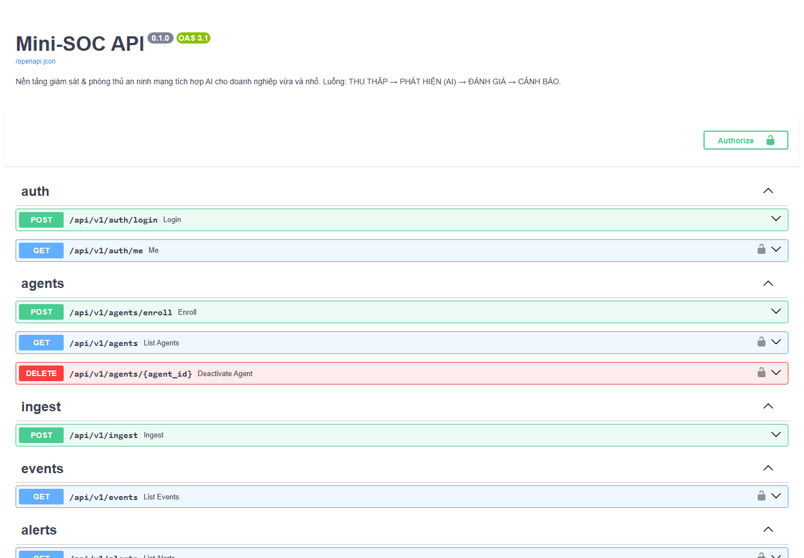
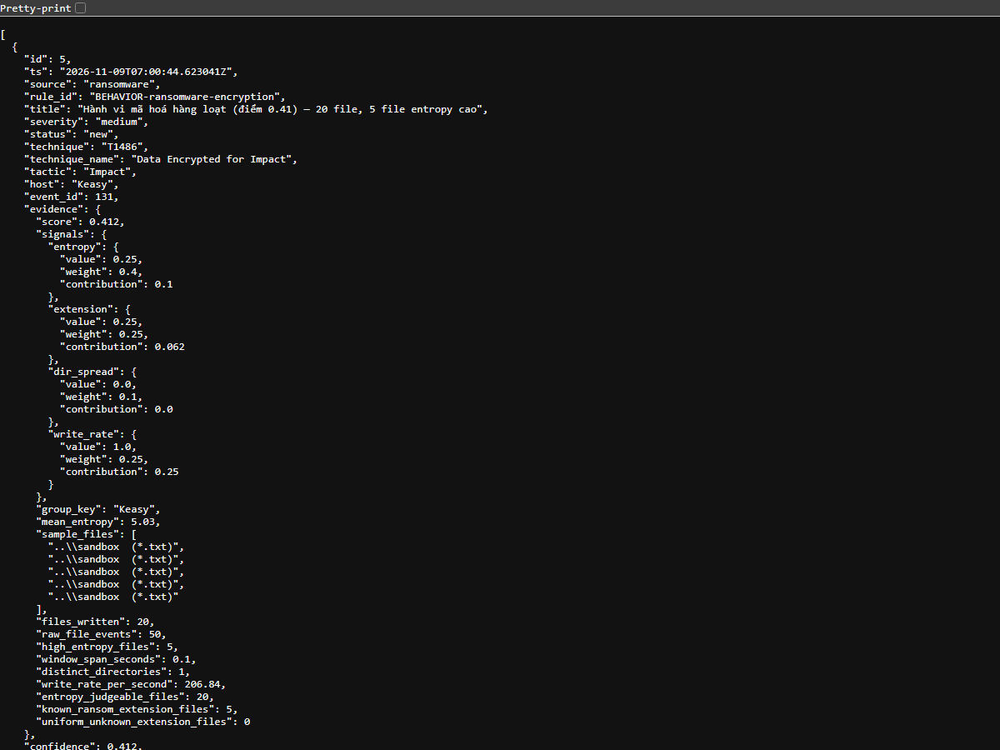

# Mini-SOC

[](https://github.com/lil-godb369/Mini_SOC/actions/workflows/ci.yml)
[](https://www.python.org/downloads/)
[](LICENSE)
[](#running-the-tests)

**An AI-assisted security monitoring and defence platform for small and medium businesses**

A small, lightweight and low-cost SOC that uses AI/ML to compensate for the fact that
most SMBs have no security specialist on staff. It covers the full loop:

```
COLLECT  →  DETECT (AI)  →  ASSESS  →  ALERT & TRAIN PEOPLE
```

> 🇻🇳 Bản tiếng Việt: [README.md](README.md)

## Architecture

```
┌─── LAYER 6: PEOPLE ───────────┐   ┌─── LAYER 5: HONEYPOT ──────┐
│ phishing email detection ·    │   │ fake SSH + fake HTTP       │
│ phishing simulation · scoring │   │ logs IP / login attempts   │
└───────────────┬───────────────┘   └──────────┬─────────────────┘
                │                              │ feeds data back
┌─── LAYER 1: COLLECTION ────────────────────┐ │  into layer 2
│  Endpoint agent (Python, cross-platform)   │ │
│   · process_create  · file_modify          │◄┘
│   · network_connect · registry_set         │
└──────────────────┬─────────────────────────┘
                   │ JSON over HTTPS → Redis Stream
                   ▼
┌─── LAYER 2: DETECTION ────────────────────────────────────┐
│  ┌────────────┐ ┌──────────────┐ ┌────────────────────┐   │
│  │ Rule engine│ │ Network ML   │ │ Ransomware behaviour│  │
│  │ YAML+ATT&CK│ │ CIC-IDS2017  │ │ entropy + IO rate   │  │
│  └────────────┘ └──────────────┘ └────────────────────┘   │
└──────────────────┬────────────────────────────────────────┘
                   │ Alerts (severity, technique, evidence)
                   ▼
┌─── LAYER 3: AI ASSISTANT ─────────────────────────────────┐
│  anonymise data → LLM → Vietnamese summary + remediation   │
└──────────────────┬────────────────────────────────────────┘
                   ▼
     PostgreSQL ──► FastAPI (JWT) ──► React dashboard
                          └──► Telegram / Webhook / Email
                   ▲
┌─── LAYER 4: ACTIVE SCANNING ──┐
│ SQLi/XSS · security headers   │
└───────────────────────────────┘
```

The key design point: **every detection layer emits the same alert shape**
(`AlertDraft` → `alerts` table). The dashboard, the notification layer and the AI
assistant therefore only need to understand one structure, regardless of whether an
alert came from an ATT&CK rule, a machine-learning model, a honeypot or a scanner.

## Status

| Layer | Status | Notes |
|---|---|---|
| 1 — Collection | ✅ Done | Python agent (process, file + entropy, network) |
| 2 — ATT&CK rule engine | ✅ Done | 5 rules, sliding-window correlation |
| 2 — Network ML | ✅ Done | CIC-IDS2017, RF/XGBoost/IsolationForest, split by day |
| 2 — Ransomware behaviour | ✅ Done | entropy + write rate + file extensions + folder spread |
| 3 — AI assistant | ⬜ Week 3 | Claude API + anonymisation layer |
| Dashboard | ⬜ Week 3 | React + Tailwind, realtime over SSE |
| 4/5/6 — Scanning, honeypot, phishing | ⬜ Week 4 | integration/demo level |

> 📖 **Already set up on this machine?** See [`HUONG-DAN-CHAY.md`](HUONG-DAN-CHAY.md)
> (Vietnamese) — a step-by-step run and demo guide, every command verified.
> Need a Docker refresher (image/container/volume, the six core commands, fixing a
> "port is already allocated" error)? See [`docs/HUONG-DAN-DOCKER.md`](docs/HUONG-DAN-DOCKER.md).

## Screenshots and a real run

`docker compose up` on Windows 11, the agent watching the `sandbox` directory, then
`attack_sim/discovery.py` and `attack_sim/ransomware_sim.py`. Result: **7 alerts**, including
1 `critical` (T1486) and 1 `medium` (T1486 — behaviour score 0.41). The T1057 rule did not
fire, exactly as documented in [Known limitations](#known-limitations) item 1.

**Auto-generated API (Swagger UI)** — `http://127.0.0.1:8000/docs`



**A real alert returned by `/api/v1/alerts`** (trimmed and redacted). Note
`evidence.signals`: it shows how much each signal (entropy, file extension, directory spread,
write rate) contributed to the final score, so the analyst can see **why** the alert fired.



## Requirements

- **Docker Desktop** — required to run PostgreSQL + Redis
  ([download](https://www.docker.com/products/docker-desktop/))
- **Python 3.9 or later** — to run the agent directly on the monitored machine
- ~2 GB free RAM, no GPU needed

## Installation and run

### 1. Configuration

```powershell
cd mini-soc
copy .env.example .env
```

Open `.env` and **change these 4 values** before running:

```powershell
# Generate a random key:
python -c "import secrets; print(secrets.token_urlsafe(48))"
```

| Variable | Meaning |
|---|---|
| `JWT_SECRET` | Signing key for login tokens |
| `POSTGRES_PASSWORD` | Database password (change it in `DATABASE_URL` too) |
| `ADMIN_PASSWORD` | Password of the first administrator account |
| `AGENT_ENROLL_TOKEN` | Token the agent uses to enrol for the first time |

### 2. Start the platform

```powershell
docker compose up -d
docker compose ps          # all 4 services must be healthy/running
```

Verify:

```powershell
curl http://127.0.0.1:8000/health
```

Auto-generated API docs: <http://127.0.0.1:8000/docs>

### 3. Run the agent on the machine to monitor

```powershell
cd agent
python -m venv .venv
.\.venv\Scripts\Activate.ps1
pip install -r requirements.txt

# First run — needs the enrolment token from .env
python -m mini_soc_agent.agent `
    --server http://127.0.0.1:8000 `
    --enroll-token <AGENT_ENROLL_TOKEN> `
    --watch-dir ..\sandbox

# Later runs, the API key has been stored:
python -m mini_soc_agent.agent --server http://127.0.0.1:8000 --watch-dir ..\sandbox
```

### 4. Attack detection demo

Open a second terminal (the agent keeps running in the first):

```powershell
cd attack_sim
python discovery.py            # T1057 — discovery command cluster
python persistence_sim.py      # T1547.001 — autostart (dry run)
python ransomware_sim.py       # T1486 — bulk file encryption inside sandbox
python ransomware_sim.py --restore    # restore the files
```

Watch alerts appear:

```powershell
docker compose logs -f worker
```

Or through the API:

```powershell
# Get a token
$token = (curl -Method POST http://127.0.0.1:8000/api/v1/auth/login `
    -ContentType "application/json" `
    -Body '{"email":"admin@minisoc.local","password":"<ADMIN_PASSWORD>"}' |
    ConvertFrom-Json).access_token

curl http://127.0.0.1:8000/api/v1/alerts -Headers @{Authorization="Bearer $token"}
```

Details of each scenario and the safety guarantees: [`attack_sim/README.md`](attack_sim/README.md).

## Running the tests

```powershell
python -m venv .venv
.\.venv\Scripts\python.exe -m pip install -r backend\requirements.txt -r ml\requirements.txt
.\.venv\Scripts\python.exe -m pytest          # from the repo root: backend and ML
```

The tests need **no Postgres, no Redis and no CIC-IDS2017 dataset** — they use
temporary SQLite, a fake Redis and synthetic data with the same shape (including
the same defects) as the real thing. That is deliberate: a test suite that requires
infrastructure to run is a test suite nobody runs.

There are currently **152 tests**, taking about 25 seconds on a 4-core machine. CI
re-runs the whole suite on every push (see the badge at the top).

## Repository layout

```
mini-soc/
├── docker-compose.yml       # 4 services: postgres, redis, api, worker
├── .env.example             # all configuration via environment variables
├── backend/
│   ├── Dockerfile           # shared by api and worker
│   └── app/
│       ├── main.py          # FastAPI: startup, CORS, health
│       ├── worker.py        # detection loop (consumes the Redis Stream)
│       ├── models.py        # users, agents, events, alerts
│       ├── security.py      # Argon2id + JWT + API key
│       ├── bus.py           # Redis Streams (consumer group, ACK)
│       ├── api/             # routers by module
│       └── detection/       # CORE — runs without a database
│           ├── pipeline.py  # chains the detectors, returns AlertDraft
│           ├── correlator.py# sliding window, injected clock
│           └── rules/       # 5 ATT&CK rules in YAML
├── agent/                   # layer 1 — runs on the monitored machine
├── attack_sim/              # red layer — scenarios that prove detection works
└── sandbox/                 # the only place ransomware simulation may write
```

## Notable engineering decisions

| Decision | Rationale |
|---|---|
| PostgreSQL JSONB **instead of** Elasticsearch | ES needs ~2 GB of JVM heap — which contradicts the project's own "lightweight for SMB" goal |
| Redis Streams **instead of** Kafka | Kafka costs >1 GB RAM and needs its own operations; Redis Streams provides consumer groups + ACK + persistence in ~50 MB |
| Synchronous SQLAlchemy, endpoints declared as `def` | The API and worker share one data layer; FastAPI runs `def` endpoints in a threadpool, so the event loop is never blocked |
| Argon2id for passwords, SHA-256 for API keys | Low-entropy passwords need a slow hash; 256-bit random API keys need a deterministic hash so they can be looked up through an index |
| **Injected** clock in the correlator | Makes window boundaries testable without `sleep`, and lets replayed data correlate correctly |
| `pipeline.py` never touches the database | The detection core — the most important part of the project — is unit-testable with plain dicts |

## Known limitations

Written down rather than hidden, because these are exactly what an evaluation panel will ask about:

1. **Polling for processes misses short-lived processes.** This is not a theoretical
   concern — it was measured during a real demo run: out of 6 discovery commands the
   agent only caught `tasklist` and `systeminfo`; `whoami`, `hostname`, `ipconfig`
   and `net` live for under 100 ms and slipped through the gap between two polls.
   The T1057 rule requires 4 processes, so **it did not fire**.

   This can be mitigated by lowering the poll interval (`--poll-interval 0.25`), but
   only a kernel-level agent (ETW on Windows, eBPF on Linux) guarantees no misses.
   That is out of scope for a 4-week project.

2. **The T1486 rule has to aggregate per host, not per PID**, because `watchdog`
   reports which file changed but not which process changed it. Consequence:
   extracting a large zip can produce a false positive. The week-2 layer reduces this
   using entropy.

3. **The T1003 rule relies on the command line only**, so renaming the executable
   evades it. Reliable detection needs handle-open telemetry against `lsass.exe`.

4. **Uses `create_all` rather than Alembic migrations.** Acceptable while the schema
   is new and there is no production data; a real deployment would need to change this.

5. **Docker Desktop on Windows cannot capture the host's real network traffic**
   (containers run inside the WSL2 VM). The layer-2 demo therefore replays a pcap.

6. **The file watcher emits many events per write.** On Windows, 20 encrypted files
   produce roughly 29–86 events. The detector already collapses them by file identity
   (the last rename in the chain), but this remains an inherent source of noise when
   monitoring at user level.

7. **The network ML model has no experimental results yet.** The training pipeline
   runs end-to-end, but only on synthetic data. Any figures in a report must be
   re-run on the original CIC-IDS2017 — see `ml/README.md`.

## Origin

The collection layer and the ATT&CK rules were ported from **PyEDR**, an earlier
small EDR project by the same author. Carried over: the shared event schema, the
5 ATT&CK rules and the 3 attack-simulation scenarios.

## License

[MIT](LICENSE) © 2026 Trần Ngọc Đăng Khoa
