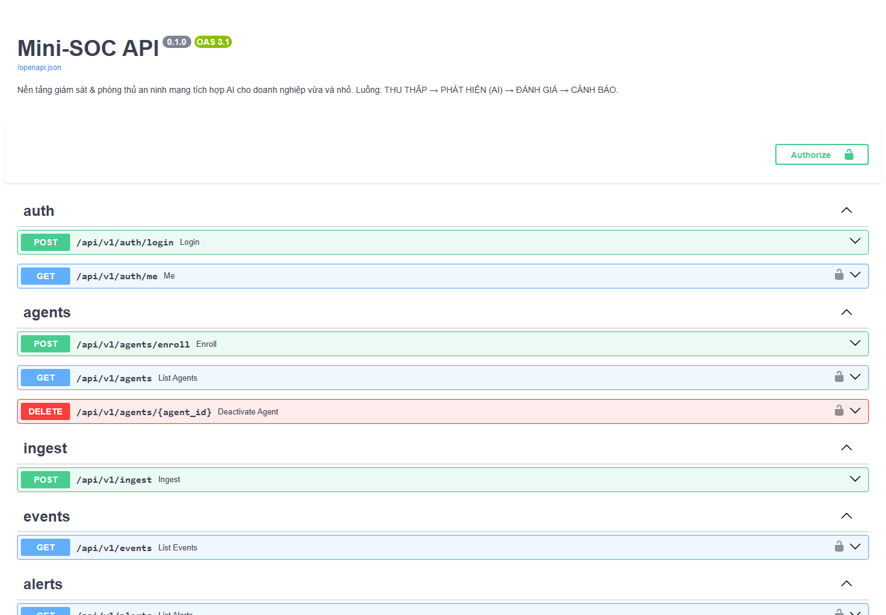
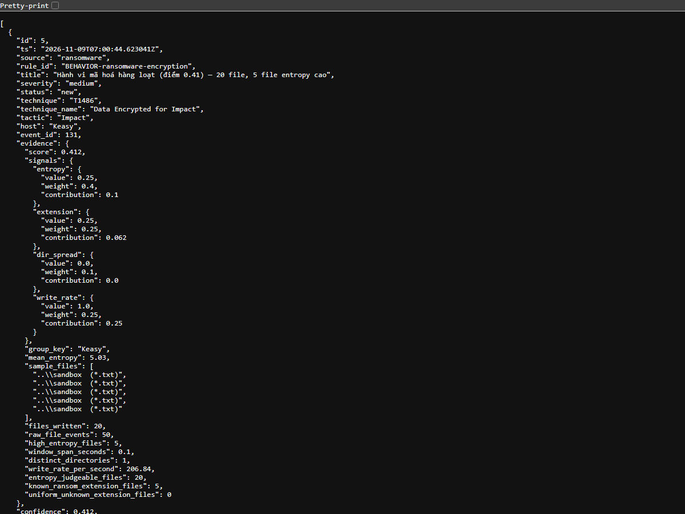

# Mini-SOC

[](https://github.com/lil-godb369/Mini_SOC/actions/workflows/ci.yml)
[](https://www.python.org/downloads/)
[](LICENSE)
[](#chạy-test)

**Nền tảng giám sát & phòng thủ an ninh mạng tích hợp AI cho doanh nghiệp vừa và nhỏ**

> 🇬🇧 English version: [README.en.md](README.en.md)

Một hệ SOC thu nhỏ, nhẹ và chi phí thấp, dùng AI/ML để bù cho việc SMB không có
chuyên gia an ninh mạng. Gom trọn luồng:

```
THU THẬP  →  PHÁT HIỆN (AI)  →  ĐÁNH GIÁ  →  CẢNH BÁO & ĐÀO TẠO CON NGƯỜI
```

## Kiến trúc

```
┌─── LỚP 6: CON NGƯỜI ──────────┐   ┌─── LỚP 5: HONEYPOT ────────┐
│ phát hiện email lừa đảo ·     │   │ SSH giả + HTTP giả          │
│ mô phỏng phishing · chấm điểm │   │ ghi IP / lần thử đăng nhập  │
└───────────────┬───────────────┘   └──────────┬──────────────────┘
                │                              │ nuôi dữ liệu ngược
┌─── LỚP 1: THU THẬP ───────────────────────┐  │  về lớp 2
│  Agent endpoint (Python, đa nền tảng)     │  │
│   · process_create  · file_modify         │◄─┘
│   · network_connect · registry_set        │
└──────────────────┬────────────────────────┘
                   │ JSON qua HTTPS → Redis Stream
                   ▼
┌─── LỚP 2: PHÁT HIỆN ──────────────────────────────────────┐
│  ┌────────────┐ ┌──────────────┐ ┌────────────────────┐  │
│  │ Rule engine│ │ ML mạng      │ │ Hành vi ransomware │  │
│  │ YAML+ATT&CK│ │ CIC-IDS2017  │ │ entropy + tốc độ IO│  │
│  └────────────┘ └──────────────┘ └────────────────────┘  │
└──────────────────┬────────────────────────────────────────┘
                   │ Cảnh báo (mức độ, kỹ thuật, bằng chứng)
                   ▼
┌─── LỚP 3: TRỢ LÝ AI ──────────────────────────────────────┐
│  ẩn danh hoá dữ liệu → LLM → tóm tắt tiếng Việt + cách xử lý│
└──────────────────┬────────────────────────────────────────┘
                   ▼
     PostgreSQL ──► FastAPI (JWT) ──► Dashboard React
                          └──► Telegram / Webhook / Email
                   ▲
┌─── LỚP 4: QUÉT CHỦ ĐỘNG ──────┐
│ SQLi/XSS · security header    │
└───────────────────────────────┘
```

Điểm mấu chốt của thiết kế: **mọi lớp phát hiện đều ghi ra cùng một dạng cảnh
báo** (`AlertDraft` → bảng `alerts`). Nhờ vậy dashboard, hệ thống thông báo và
lớp trợ lý AI chỉ cần hiểu đúng một cấu trúc, dù cảnh báo đến từ rule ATT&CK,
mô hình học máy, honeypot hay bộ quét lỗ hổng.

## Trạng thái

| Lớp | Trạng thái | Ghi chú |
|---|---|---|
| 1 — Thu thập | ✅ Xong | Agent Python (tiến trình, file + entropy, mạng) |
| 2 — Rule engine ATT&CK | ✅ Xong | 5 rule, tương quan theo cửa sổ trượt |
| 2 — ML mạng | ✅ Xong | CIC-IDS2017, RF/XGBoost/IsolationForest, chia theo ngày |
| 2 — Hành vi ransomware | ✅ Xong | entropy + tốc độ ghi + đuôi file + độ lan thư mục |
| 3 — Trợ lý AI | ⬜ Tuần 3 | Claude API + lớp ẩn danh hoá |
| Dashboard | ⬜ Tuần 3 | React + Tailwind, realtime qua SSE |
| 4/5/6 — Quét, honeypot, phishing | ⬜ Tuần 4 | mức tích hợp/demo |

> 📖 **Đã cài đặt xong trên máy này?** Xem [`HUONG-DAN-CHAY.md`](HUONG-DAN-CHAY.md)
> — hướng dẫn chạy và trình diễn từng bước, mọi lệnh đều đã kiểm chứng.

## Ảnh chụp & kết quả chạy thật

Chạy `docker compose up` trên Windows 11, agent theo dõi thư mục `sandbox`, sau đó chạy
`attack_sim/discovery.py` và `attack_sim/ransomware_sim.py`. Kết quả: **7 cảnh báo**, trong đó
1 `critical` (T1486) và 1 `medium` (T1486 — điểm hành vi 0.41). Rule T1057 không kích hoạt,
đúng như đã ghi ở mục [Hạn chế đã biết](#hạn-chế-đã-biết) số 1.

**API tự sinh (Swagger UI)** — `http://127.0.0.1:8000/docs`



**Cảnh báo thật trả về từ `/api/v1/alerts`** (đã rút gọn và che thông tin nhạy cảm). Chú ý
`evidence.signals`: từng tín hiệu (entropy, phần mở rộng, độ lan thư mục, tốc độ ghi) đóng góp
bao nhiêu vào điểm cuối, nên người phân tích thấy được **vì sao** cảnh báo bật.



## Yêu cầu hệ thống

- **Docker Desktop** — bắt buộc để chạy PostgreSQL + Redis
  ([tải tại đây](https://www.docker.com/products/docker-desktop/))
- **Python 3.9 trở lên** — để chạy agent trực tiếp trên máy được giám sát
- RAM trống ~2GB, không cần GPU

## Cài đặt và chạy

### 1. Cấu hình

```powershell
cd mini-soc
copy .env.example .env
```

Mở `.env` và đổi **bắt buộc** 4 giá trị sau trước khi chạy:

```powershell
# Sinh khoá ngẫu nhiên:
python -c "import secrets; print(secrets.token_urlsafe(48))"
```

| Biến | Ý nghĩa |
|---|---|
| `JWT_SECRET` | Khoá ký token đăng nhập |
| `POSTGRES_PASSWORD` | Mật khẩu CSDL (nhớ sửa cả trong `DATABASE_URL`) |
| `ADMIN_PASSWORD` | Mật khẩu tài khoản quản trị đầu tiên |
| `AGENT_ENROLL_TOKEN` | Token để agent đăng ký lần đầu |

### 2. Khởi động nền tảng

```powershell
docker compose up -d
docker compose ps          # cả 4 service phải ở trạng thái healthy/running
```

Kiểm tra:

```powershell
curl http://127.0.0.1:8000/health
```

Tài liệu API tự sinh: <http://127.0.0.1:8000/docs>

### 3. Chạy agent trên máy cần giám sát

```powershell
cd agent
python -m venv .venv
.\.venv\Scripts\Activate.ps1
pip install -r requirements.txt

# Lần đầu — cần token đăng ký lấy từ .env
python -m mini_soc_agent.agent `
    --server http://127.0.0.1:8000 `
    --enroll-token <AGENT_ENROLL_TOKEN> `
    --watch-dir ..\sandbox

# Những lần sau, API key đã được lưu lại:
python -m mini_soc_agent.agent --server http://127.0.0.1:8000 --watch-dir ..\sandbox
```

### 4. Demo phát hiện tấn công

Mở cửa sổ thứ hai (agent vẫn đang chạy ở cửa sổ trước):

```powershell
cd attack_sim
python discovery.py            # T1057 — cụm lệnh do thám
python persistence_sim.py      # T1547.001 — tự khởi động (chạy khô)
python ransomware_sim.py       # T1486 — mã hoá file hàng loạt trong sandbox
python ransomware_sim.py --restore    # trả file về nguyên trạng
```

Xem cảnh báo hiện lên:

```powershell
docker compose logs -f worker
```

Hoặc qua API:

```powershell
# Lấy token
$token = (curl -Method POST http://127.0.0.1:8000/api/v1/auth/login `
    -ContentType "application/json" `
    -Body '{"email":"admin@minisoc.local","password":"<ADMIN_PASSWORD>"}' |
    ConvertFrom-Json).access_token

curl http://127.0.0.1:8000/api/v1/alerts -Headers @{Authorization="Bearer $token"}
```

Chi tiết về từng kịch bản và cam kết an toàn: [`attack_sim/README.md`](attack_sim/README.md).

## Chạy test

```powershell
python -m venv .venv
.\.venv\Scripts\python.exe -m pip install -r backend\requirements.txt -r ml\requirements.txt
.\.venv\Scripts\python.exe -m pytest          # chạy từ thư mục gốc: cả backend lẫn ML
```

Test **không cần Postgres, Redis, hay bộ dữ liệu CIC-IDS2017** — dùng SQLite
tạm, Redis giả, và dữ liệu tổng hợp có cùng hình dạng (kể cả các lỗi) với bộ
thật. Đây là chủ ý: bộ test nào đòi hạ tầng mới chạy được thì rốt cuộc sẽ không
ai chạy.

Hiện có **152 test**, chạy khoảng 25 giây trên máy 4 nhân. CI chạy lại toàn bộ
bộ test này trên mỗi lần push (xem badge ở đầu README).

## Cấu trúc thư mục

```
mini-soc/
├── docker-compose.yml       # 4 service: postgres, redis, api, worker
├── .env.example             # toàn bộ cấu hình qua biến môi trường
├── backend/
│   ├── Dockerfile           # dùng chung cho api và worker
│   └── app/
│       ├── main.py          # FastAPI: khởi tạo, CORS, health
│       ├── worker.py        # vòng lặp phát hiện (tiêu thụ Redis Stream)
│       ├── models.py        # users, agents, events, alerts
│       ├── security.py      # Argon2id + JWT + API key
│       ├── bus.py           # Redis Streams (consumer group, ACK)
│       ├── api/             # router theo module
│       └── detection/       # LÕI — chạy được không cần CSDL
│           ├── pipeline.py  # ghép các bộ phát hiện, trả AlertDraft
│           ├── correlator.py# cửa sổ trượt, đồng hồ tiêm từ ngoài
│           └── rules/       # 5 rule ATT&CK dạng YAML
├── agent/                   # lớp 1 — chạy trên máy được giám sát
├── attack_sim/              # lớp đỏ — kịch bản chứng minh phát hiện
└── sandbox/                 # nơi duy nhất mô phỏng ransomware được ghi
```

## Quyết định kỹ thuật đáng chú ý

| Quyết định | Lý do |
|---|---|
| PostgreSQL JSONB **thay cho** Elasticsearch | ES cần ~2GB JVM heap — mâu thuẫn với chính mục tiêu "nhẹ cho SMB" của đồ án |
| Redis Streams **thay cho** Kafka | Kafka tốn >1GB RAM và cần vận hành riêng; Redis Streams cho đủ consumer group + ACK + lưu bền với ~50MB |
| SQLAlchemy đồng bộ, endpoint khai báo `def` | API và worker dùng chung một tầng dữ liệu; FastAPI tự chạy `def` trong threadpool nên không chặn event loop |
| Argon2id cho mật khẩu, SHA-256 cho API key | Mật khẩu entropy thấp cần băm chậm; API key ngẫu nhiên 256-bit cần băm tất định để tra cứu bằng index |
| Đồng hồ **tiêm vào** correlator | Test được ranh giới cửa sổ mà không phải `sleep`, và phát lại dữ liệu cũ vẫn tương quan đúng |
| `pipeline.py` không chạm CSDL | Lõi phát hiện — phần quan trọng nhất của đồ án — unit test được bằng dict thuần |

## Hạn chế đã biết

Ghi ra đây thay vì giấu đi, vì đây là những điểm hội đồng sẽ hỏi:

1. **Thăm dò tiến trình theo chu kỳ bỏ sót tiến trình sống ngắn.** Đây không
   phải lo ngại lý thuyết — đo được khi chạy demo thật: trong 6 lệnh do thám,
   agent chỉ bắt được `tasklist` và `systeminfo`; `whoami`, `hostname`,
   `ipconfig`, `net` sống dưới 100ms nên lọt qua khe giữa hai lần quét. Rule
   T1057 cần 4 tiến trình nên **không kích hoạt**.

   Giảm nhẹ được bằng cách hạ chu kỳ quét (`--poll-interval 0.25`), nhưng chỉ
   agent mức kernel (ETW trên Windows, eBPF trên Linux) mới bảo đảm không bỏ
   sót. Nằm ngoài phạm vi 4 tuần.
2. **Rule T1486 phải gom theo host, không theo PID**, vì `watchdog` báo file nào
   bị đổi nhưng không cho biết tiến trình nào gây ra. Hệ quả: giải nén một file
   zip lớn có thể tạo cảnh báo giả. Lớp 2 của Tuần 2 giảm việc này bằng entropy.
3. **Rule T1003 chỉ dựa trên dòng lệnh**, nên né được bằng cách đổi tên file
   thực thi. Phát hiện đáng tin cậy cần telemetry mở handle tới `lsass.exe`.
4. **Dùng `create_all` thay vì Alembic migration.** Chấp nhận được khi schema
   còn mới và chưa có dữ liệu sản xuất; lên production thật thì phải đổi.
5. **Docker Desktop trên Windows không bắt được lưu lượng mạng thật của host**
   (container chạy trong VM WSL2). Lớp 2 demo bằng phát lại pcap.

6. **Bộ theo dõi file bắn nhiều event cho một lần ghi.** Trên Windows, 20 file
   bị mã hoá sinh ra khoảng 29-86 event. Bộ phát hiện đã gộp theo danh tính file
   (lần được cả chuỗi đổi tên), nhưng đây vẫn là nguồn nhiễu vốn có của việc
   theo dõi ở tầng người dùng.

7. **Mô hình ML mạng chưa có số liệu thực nghiệm.** Đường ống huấn luyện đã chạy
   đầu-cuối, nhưng mới trên dữ liệu tổng hợp. Số liệu trong báo cáo phải chạy
   lại trên CIC-IDS2017 gốc — xem `ml/README.md`.

## Nguồn gốc

Lớp thu thập và các rule ATT&CK được port từ **PyEDR**, một dự án EDR thu nhỏ
trước đó của cùng tác giả. Phần được mang sang: schema event chung, 5 rule ATT&CK
và 3 kịch bản mô phỏng tấn công.
